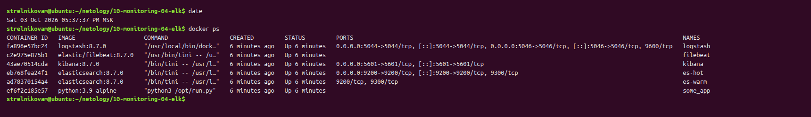
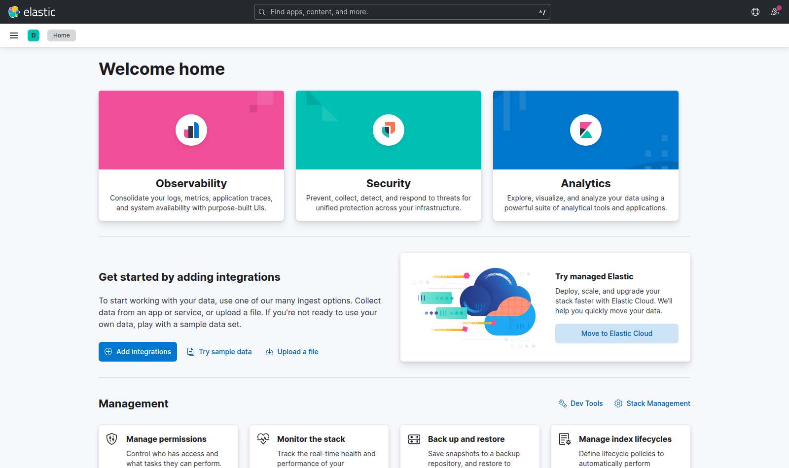
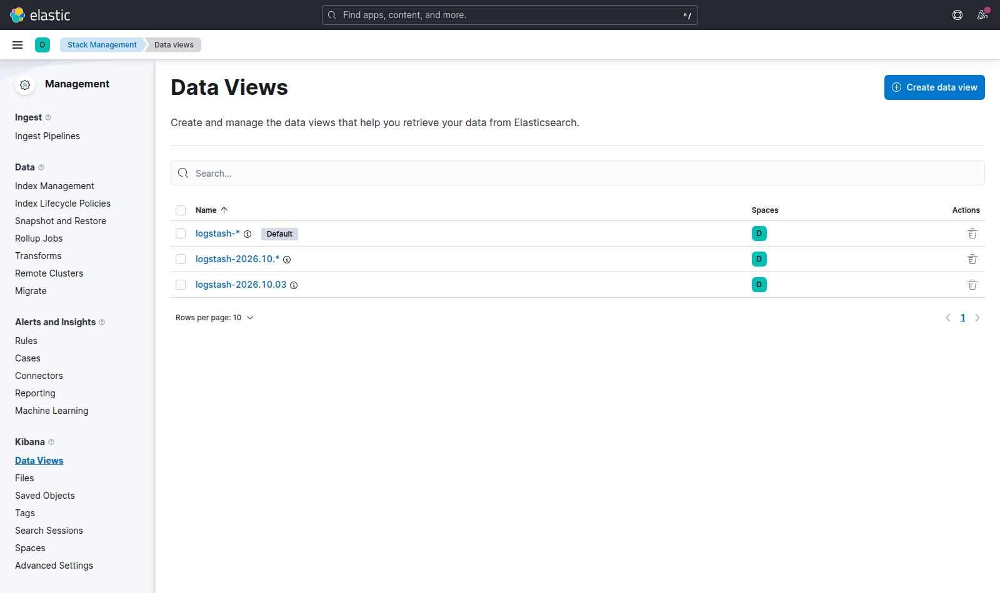
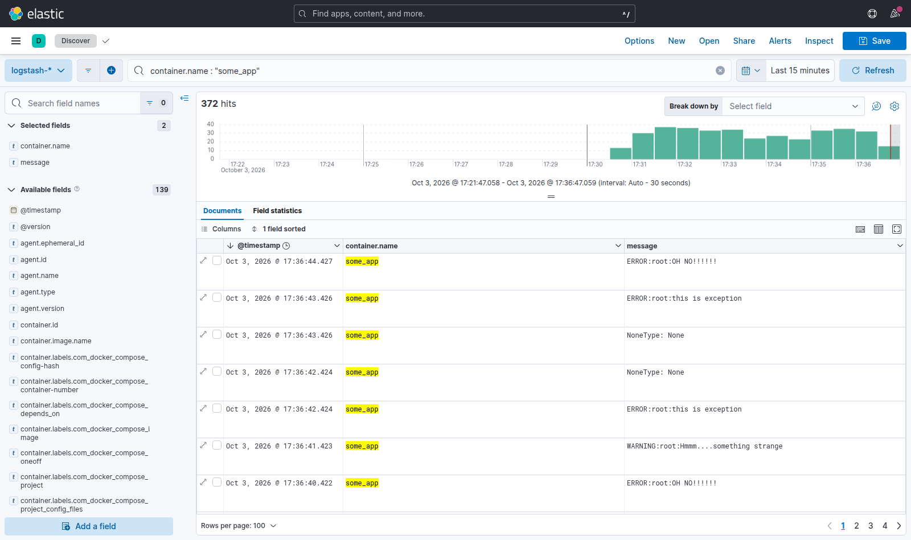
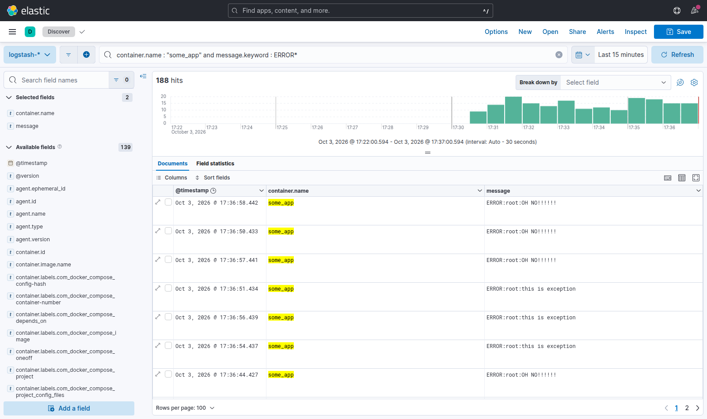
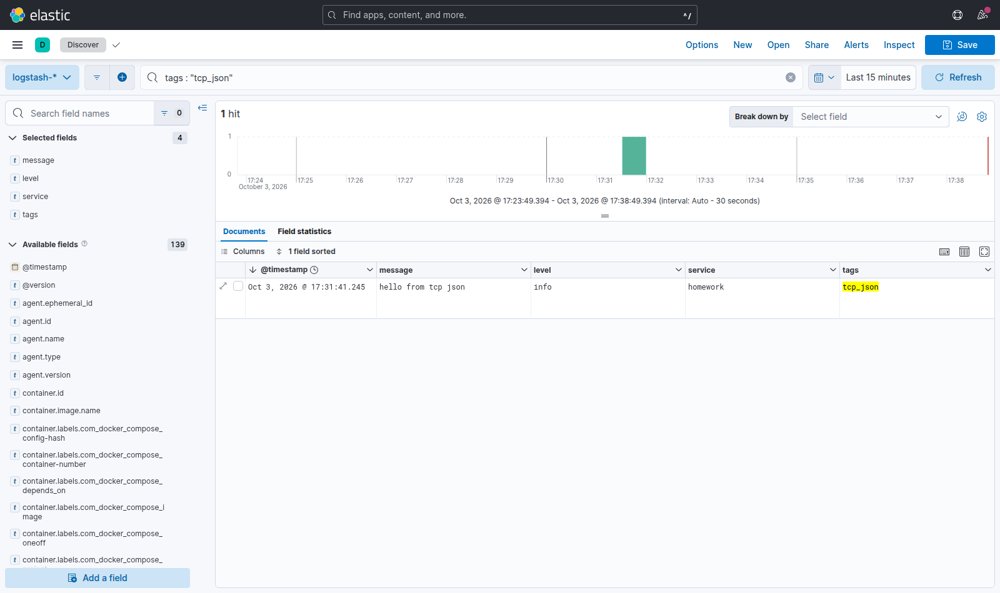

# Домашнее задание к занятию 15 «Система сбора логов Elastic Stack» - Стрельников Александр

## Задание 1

Вам необходимо поднять в докере и связать между собой:

- elasticsearch (hot и warm ноды);
- logstash;
- kibana;
- filebeat.

Logstash следует сконфигурировать для приёма по tcp json-сообщений.

Filebeat следует сконфигурировать для отправки логов docker вашей системы в logstash.

В директории [help](./help) находится манифест docker-compose и конфигурации filebeat/logstash для быстрого 
выполнения этого задания.

Результатом выполнения задания должны быть:

- скриншот `docker ps` через 5 минут после старта всех контейнеров (их должно быть 5);
- скриншот интерфейса kibana;
- docker-compose манифест (если вы не использовали директорию help);
- ваши yml-конфигурации для стека (если вы не использовали директорию help).

**Решение:**

`docker ps` через 5 минут после старта.

Интерфейс Kibana:

#
## Задание 2

Перейдите в меню [создания index-patterns  в kibana](http://localhost:5601/app/management/kibana/indexPatterns/create) и создайте несколько index-patterns из имеющихся.

Перейдите в меню просмотра логов в kibana (Discover) и самостоятельно изучите, как отображаются логи и как производить поиск по логам.

В манифесте директории help также приведенно dummy-приложение, которое генерирует рандомные события в stdout-контейнера.
Эти логи должны порождать индекс logstash-* в elasticsearch. Если этого индекса нет — воспользуйтесь советами и источниками из раздела «Дополнительные ссылки» этого задания.

**Решение:**

В Kibana 8 index patterns называются Data Views. Созданы три (time field — `@timestamp`):

- `logstash-*` — все логи (по умолчанию);
- `logstash-2026.10.*` — логи за октябрь;
- `logstash-2026.10.03` — индекс за текущий день (лежит на hot-ноде).

Discover, логи dummy-приложения — запрос KQL `container.name : "some_app"`, колонки `container.name` и `message`:

Поиск только ошибок приложения: `container.name : "some_app" and message.keyword : ERROR*`.
Полнотекстовый поиск `message : "OH NO"` здесь ничего не находит: standard-анализатор не разбивает слова, разделённые двоеточием, и строка `ERROR:root:OH NO!!!!!!` превращается в токены `["error:root:oh", "no"]` (проверено через `_analyze`). Поэтому фильтрация по префиксу идёт по неанализируемому полю `message.keyword`.

Сообщение, отправленное в logstash по tcp как json, — запрос `tags : "tcp_json"`. Поля json (`message`, `level`, `service`) стали отдельными полями документа:

